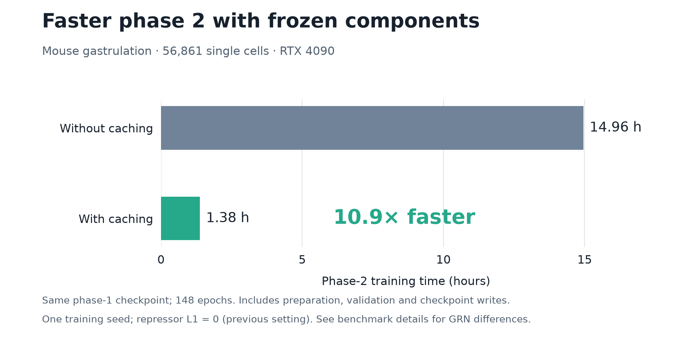

# scDORI: Single-cell Deep Multi-Omic Regulatory Inference
[](https://doi.org/10.5281/zenodo.21937078)
[](https://scdori.readthedocs.io/en/latest/)
[](https://codecov.io/gh/bioFAM/scDoRI)


**scDORI** is a deep learning model for single-cell **multiome** data (RNA + ATAC in same cell) that infers **enhancer-mediated gene regulatory networks (eGRNs)**. By combining an **encoder–decoder** approach with mechanistic constraints (enhancer–gene links, TF binding logic), scDORI learns **topics** that group co-accessible peaks, their cis-linked genes and upstream activator and repressor TFs – all while scaling to large datasets via mini-batches.

scDORI is described in [Saraswat et al., *Nature* 2026](https://www.nature.com/articles/s41586-026-11177-0).

## Highlights
- 🔄 **Unified** approach: a single model for dimensionality reduction + eGRN inference
- 🧠 Learns **topics** that represent cell-state-specific regulatory programs
- 🧬**Continuous eGRN modelling** : each cell is a mixture of topics, allowing the study of changes in GRNs. No need for predefined clusters
- 🧰 **Scalable** to large datasets via **mini-batch training**

## What's new in v2.0.0

- **Faster phase 2:** the fixed phase-1 calculations are cached instead of being repeated for
  every minibatch: **10.9× faster phase-2 training** in a matched single-cell benchmark
  ([timings](#training-performance)).
- **Regularisation now works:** in v1.0.0 the L1 and L2 penalties were computed on detached tensors,
  so they never affected training.
- **A clearer TF-expression rule:** a TF is compared with other TFs in a topic and with its own
  expression in other topics, and it needs measured RNA in that topic's top cells.
- **Review before continuing:** check topic use, cell maps and gene and TF programs after phase 1.
- **Clearer notebooks:** the same three notebooks and one shared config, with fuller explanations of
  how to read each result.

**Upgrading from v1.0.0:** fitted results differ, so refit your data rather than comparing networks
across versions. The [changelog](CHANGELOG.md) lists the new defaults and how to restore them.

## Input Requirements

scDORI expects **single-cell multiome data** with the following inputs:

- `RNA`: an AnnData `.h5ad` object with **cells × genes** expression matrix
- `ATAC`: an AnnData `.h5ad` object with **cells × peaks** accessibility matrix
  - Name peaks as `chr:start-end` (for example `chr1:1000-1200`); preprocessing creates the coordinate columns from these names.

These datasets must be paired — i.e., RNA and ATAC should come from the **same cells**. Make sure that **.X** of anndata objects contain raw counts.


## Installation

Use Python 3.10–3.12 in a fresh environment. Install PyTorch for your CPU or GPU
using the [official selector](https://pytorch.org/get-started/locally/), then:

```bash
git clone https://github.com/bioFAM/scDoRI.git
cd scDoRI
python -m pip install -e '.[all]'
```

For training on processed data, `python -m pip install -e .` installs only the
core dependencies. Optional extras separate preprocessing, plotting, notebooks
and downstream integrations. Editable mode is optional.

The [setup guide](docs/installation.md) gives the complete installation steps,
including BEDTools for preprocessing and GPU setup.

**Hardware.** Training is GPU-accelerated and **highly recommended** on a GPU-enabled machine. While
preprocessing can run on CPU, training large datasets on CPU is not advised due to slow performance.
GPU memory scales with the number of selected features; as a guide, a GPU with 12–15 GB of memory
supports ~4,000 genes, 70,000 peaks and 300 TFs. Larger feature sets require proportionally more memory.


## Usage
Use the same three notebooks: **Preprocessing → Training → Downstream analysis**.
For a new project, copy the shared configuration template into the repository root:

```bash
cp configs/scdori.example.json scdori_config.json
python -m jupyter lab
```

Edit the data/reference paths and parameters in `scdori_config.json`, then open
the notebooks below in order. All three find that file from the repository root
or a notebook subdirectory. Relative paths resolve beside the config file.
Preprocessing output paths feed training automatically unless overridden, and
downstream uses the same training settings/checkpoint location.

| Step | Notebook | What you will do | What you get |
| --- | --- | --- | --- |
| 1 | [Preprocessing](docs/notebooks/preprocessing.ipynb) | Select genes, TFs and peaks; prepare binding scores and peak–gene information. | Preprocessed RNA and ATAC AnnData objects, in-silico ChIP-seq TF–peak matrices and gene–peak distance matrices. |
| 2 | [Training](docs/notebooks/training.ipynb) | Learn topics, inspect their cell and gene patterns, then learn the networks. | A trained checkpoint, topic activities and topic–peak, topic–gene and topic–TF matrices. |
| 3 | [Downstream](docs/notebooks/downstream.ipynb) | Explore programs, enriched gene sets, TF targets, repressors and linked regions. | Topic-specific eGRNs, TF activity scores, tables and figures. |

**Run All trains both phases.** To inspect topics first, set `RUN_PHASE2=False`
near the top of training. After reviewing the plots, continue from the phase-2
section without repeating phase 1. Almost-unused topics are skipped to make
phase 2 faster; `grn_topic_selection="all"` keeps them.

Each notebook explains the choices where they are used. The
[settings reference](docs/notebook_settings.md) brings them together if you want
to compare settings. The original Python configs still work when no JSON config
is selected: `src/scdori/pp/config.py` and `src/scdori/_core/config.py`.

## Choosing settings and checking results

- The [hyperparameter guide](docs/training_guide.rst) helps you choose features, topics, regularisation
  and training length. A recommended starting point is `#topics = expected number of cell types + 10`.
- [Best practices](docs/best_practices.md) shows how far results change between fits. Repeating phase 2
  keeps top links almost unchanged, but training phase 1 again reorders them. If your conclusions rest
  on particular targets or one topic, train phase 1 with several seeds and report what recurs.

## Dataset Demonstration

The provided notebooks use the **mouse gastrulation dataset** from:

📄 Paper: [Argelaguet et al., Bioarxiv 2022](https://www.biorxiv.org/content/10.1101/2022.06.15.496239v1)
📦 Download: [Dropbox link](https://www.dropbox.com/scl/fo/9inmw43pz2bygtqepxl82/ALeeNjuEqw4qp0L9Z9t71xo/data/processed?rlkey=5ihgkvafegkke9jnldlnhw1x6&subfolder_nav_tracking=1&st=cixvwynt&dl=0). The whole folder is about 79 GB as one download; preprocessing needs only `anndata.h5ad` and `PeakMatrix_anndata.h5ad`.

See the [completed single-cell example](docs/gastrulation_example.md) for its phase-1 topic plots, TF rankings
and target genes, and what to inspect at each step.

## Training performance

Caching makes phase 2 **10.9× faster** on the mouse gastrulation example (56,861 cells, one RTX 4090), without changing the fit beyond rounding.



At the current defaults, a whole run on this example took **3 to 5 hours**. See the [training time page](docs/gastrulation_benchmark.md).

## Configuration Notes

The shared JSON `preprocessing` section (or `src/scdori/pp/config.py`) provides flexible options:

- You can **set the number of peaks, genes, and TFs** to use for model training
  - 💡 Tip: Adjust based on your available **GPU memory**
- You can also **retain specific genes, TFs or peaks**, even if they aren’t highly variable
  - Useful for focusing on known regulators/ genes of interest
  - See [settings and retention rules](docs/notebook_settings.md#keep-genes-tfs-and-peaks-you-choose) for matching names, motif requirements and when to rerun preprocessing

## Documentation
📖 Full documentation and API reference is hosted at: https://scdori.readthedocs.io/en/latest/

Includes:
- API reference (docstrings)
- In-depth method overview
- Preprocessing + training guides
- [Hyperparameter guide](docs/training_guide.rst): features, topics, regularisation, training length
- [Best practices](docs/best_practices.md): repeating fits, keeping common links, rare cell types

## Citation
If you use scDORI in your work, please cite our [paper](https://www.nature.com/articles/s41586-026-11177-0):

Saraswat, M. et al. Decoding the regulatory programs governing glioblastoma plasticity. *Nature* (2026). https://doi.org/10.1038/s41586-026-11177-0

Feel free to open an issue or get in touch at manu.saraswat@dkfz.de
