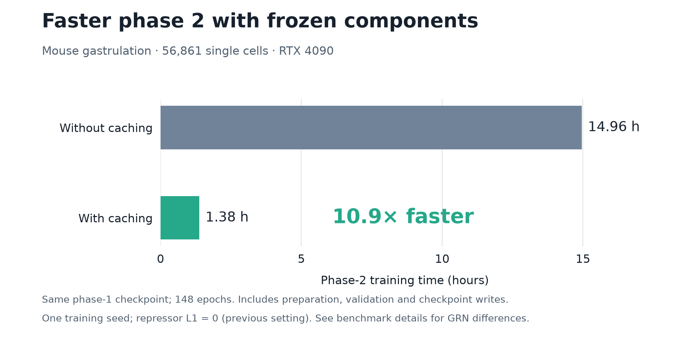

# Training time

Keeping phase 1 fixed lets scDORI compute its per-cell calculations once and reuse them. On the mouse gastrulation example (56,861 cells, one RTX 4090), this made **phase 2 10.9× faster**.

Caching does not change the fit beyond rounding. Both runs stopped at the same epoch, held-out loss agreed to within 0.00004%, and their 1,000 strongest links were the same. Weaker activator links differ more, because rounding differences accumulate over training. This comparison used one seed and the earlier penalties and TF-expression rule.

At the current defaults, a whole run on the example took **3 to 5 hours**:

| Step | Time |
| --- | ---: |
| Preprocessing (64 cores) | 13 min |
| Phase 1 | 2 to 3 h, depending on the seed |
| Phase 2 | 53 to 75 min |
| Downstream notebook, with 1,000 permutations | 17 to 26 min |

Your times will depend on your data and hardware. The [timing table](_static/benchmarks/gastrulation_20260925/phase2_timing.csv) holds the measured values for the comparison above.
