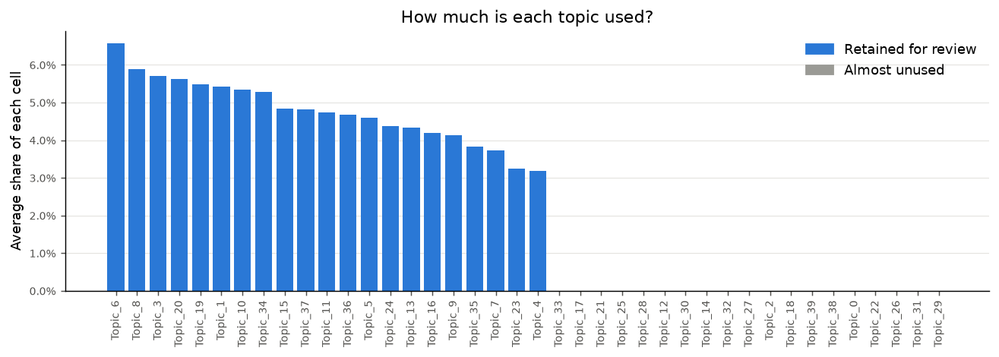
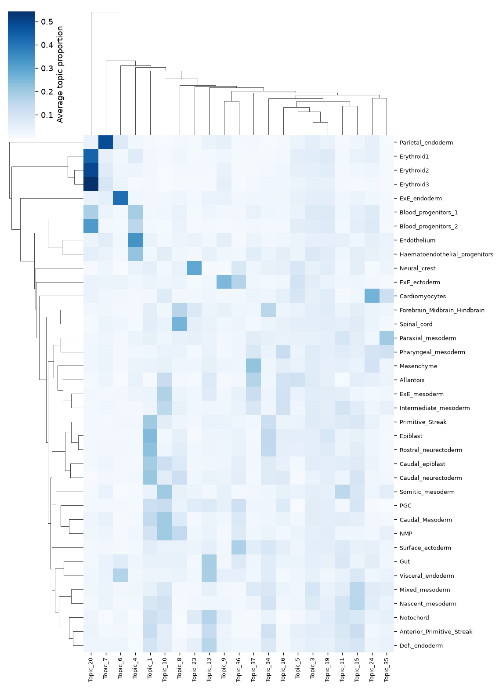
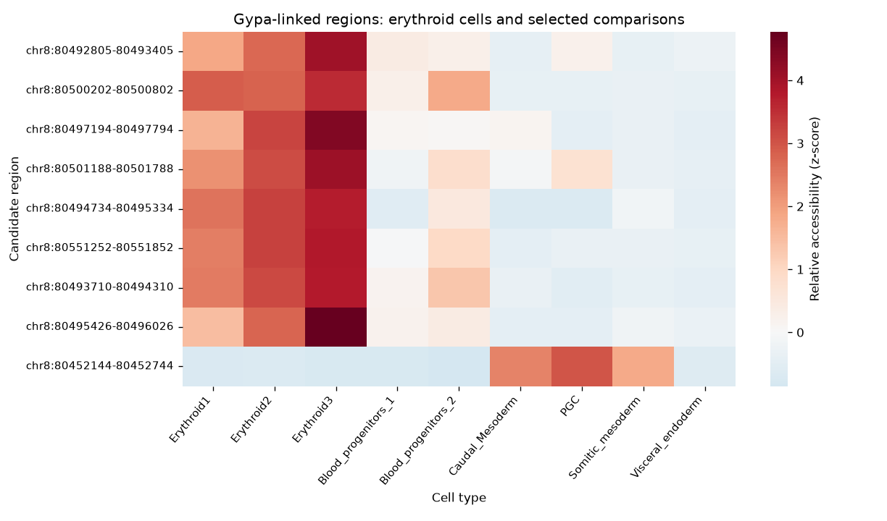

# A single-cell gastrulation example

This example shows a completed run on the repository's processed mouse gastrulation
single-cell data: **56,861 cells, 4,000 genes, 90,000 peaks and 300 TFs**.
It illustrates what to inspect between training phases and how to read the downstream
rankings. It is one fit, rather than a rule for how many topics another dataset needs,
and it has the clearest erythroid program of the three fits we compared.

## First, inspect the topics

Forty topics were fitted. Nineteen met the almost-unused rule, leaving 21 for review.
The rule checks both the largest topic weight across the reviewed cells and its mean
weight; a low overall average alone is insufficient to exclude a rare program.

A bar shows the **average share of each cell's topic mixture**, not the percentage
of cells using that topic. A small bar can still describe an important rare population.
Use the cell map, annotations and gene programs to investigate it before deciding.

Here, erythroid populations use Topic 20 strongly, while parietal endoderm uses
Topic 7 strongly. Other topics are shared across populations. These are patterns
in this fit; topic numbers are not biological labels and change after retraining
(see [Best practices](best_practices.md)).
The heatmap describes average topic use, not enrichment significance or proof of
individual regulatory links.

We skipped the nineteen almost-unused topics in phase 2, the default. Keeping all
forty is also available. The retained topics kept their original numbers.

## Then, learn and explore the networks

This run used frozen, cached phase 2, L1 coefficients of `5e-5` for both activator
and repressor weights, and the `mean_within_across` TF-expression rule
with cutoff `0.2` and a 2% detection floor. That expression rule affects training: changing it requires a
new phase-2 fit. It is distinct from scaling TF scores for interpretation.

Downstream, we asked two questions separately for activators and repressors:

| Comparison | Question |
| --- | --- |
| Within a topic | Which TFs contribute most compared with other TFs here? |
| Across topics | Where does this particular TF contribute most? |
| Mean of both | Which TFs rank highly when both questions have equal weight? |

The exported score matrices contain 21 topics and 300 TFs for each sign. The
skipped topics are absent from the scaling reference. These relative rankings are not confidence scores. [Interpreting the scores](interpretation.md).

## Erythroid TFs and candidate regions

Gata1 has activator and repressor links in Topic 20, which erythroid cells use most; its leading activator targets include
Hmbs, Tmcc2, Kcnn4, Rhag, Alas2 and Gypa. Tal1 is an RNA gene in this fit but is
absent from its 300 modelled TFs. A Tal1 network requires including it with matching
motif inputs during preprocessing and retraining.

This view compares nine cell types; the full notebook heatmap covers 37. The colours compare each region across cell types; they are not link
strength or evidence of enhancer function.

Eight regions show higher relative accessibility in erythroid cells. The ninth,
`chr8:80452144-80452744`, has low link weight (0.0142), low mean accessibility in
Erythroid3 (0.009) and stronger relative accessibility in PGC and caudal
mesoderm. It remains visible, rather than being silently removed.

For this fit, requiring mean accessibility >0.05 retains eight regions; requiring
link weight >0.05 retains seven. These are descriptive sensitivity checks, not
validated universal thresholds. The cell-level region score uses all nine regions.
Recompute that score if changing the selected region set.

## How long it took, and what was checked

With one RTX 4090, phase 1 took 137.8 minutes, phase 2 about 75 minutes and the downstream
notebook 17 to 20 minutes with 1,000 permutations. For measured speed improvements and their
conditions, see [training time](gastrulation_benchmark.md).

All three notebooks ran without errors. Reruns of the downstream notebook on the same fit
reproduced the network arrays and all 600 regulon tables byte for byte. This checks repeatability
on one fit, not stability across trained models, which [Best practices](best_practices.md) covers.
